# UPI Sentinel

**UPI Sentinel: An Explainable Multi-Agent System for Investigating Suspicious UPI Transaction Networks and Potential Mule Accounts**

UPI Sentinel is a local, academic proof of concept for reviewing transaction-network patterns. It validates transaction records, builds an accepted-record account graph, applies deterministic rules, and presents traceable investigation leads. **A finding is a lead for human review, not proof of fraud or mule-account activity.**

## Problem and scope

Investigators may need to connect separate transaction rows by sender, receiver, amount, and time. Row-by-row review can make rapid pass-through chains or multiple senders converging on an intermediary harder to inspect. UPI Sentinel demonstrates a repeatable way to validate records, connect accepted transactions, and show the source evidence behind configured pattern matches.

The project uses a small, entirely synthetic fixture. It does not connect to a bank, contain real customer transactions, train a model, integrate PaySim, or estimate real-world fraud performance. Its thresholds are illustrative and require human interpretation.

## Repository contents

- `app.py`: Streamlit dashboard.
- `src/`: schema, validation, graph, rules, workflow agents, local Ollama helper, and visualization.
- `tests/`: pytest coverage for workflow, UI helpers, graph, validation, and LLM helper.
- `data/samples/synthetic_transactions.csv`: bundled synthetic transaction fixture.
- `assets/`: dashboard logo.
- `.streamlit/config.toml`: Streamlit theme and server settings.
- `docs/acceptance_report.md`: earlier end-to-end audit and scenario review.
- `docs/UPI_Sentinel_CA3_Report.docx`: CA-3 project report.
- `presentation/`: current final PPT, presenter notes, and source materials.
- `requirements.txt`: pinned application and test dependencies.

The current final deck is `presentation/UPI_Sentinel_CA3_PPT.pptx`; the timed talk track and viva notes are in `presentation/PRESENTER_NOTES_REFINED.md`.

## Setup and launch

Tested with Python 3.12.10. From the repository root, create and activate a virtual environment, install the pinned dependencies, and launch Streamlit:

```powershell
py -3.12 -m venv .venv
.\.venv\Scripts\Activate.ps1
python -m pip install -r requirements.txt
python -m streamlit run app.py
```

On macOS or Linux, activate with `source .venv/bin/activate` after creating the environment with `python3 -m venv .venv`.

In the dashboard, choose **Load synthetic fixture** or upload a CSV, inspect the preview, set rule thresholds if needed, and press **Run analysis**. The analysis runs locally through the same `run_analysis()` workflow in `src/agents.py`.

The bundled file is `data/samples/synthetic_transactions.csv`. To regenerate it using the default fixed seed, run:

```powershell
python -m src.generate_synthetic
```

That command writes the generator's default output to the bundled CSV. Do not run it if you need to preserve local edits to that file. For a separate reproducible copy, choose a new output path:

```powershell
python -m src.generate_synthetic --output data/samples/synthetic_transactions_regenerated.csv --seed 20261012
```

Run the full test suite:

```powershell
python -m pytest -q
```

Latest local verification on 2026-10-19: **64 passed**.

## Canonical transaction input

Required columns are `transaction_id`, `time`, `sender_id`, `receiver_id`, `amount`, and `transaction_type`. Optional `label` is reserved for post-detection transaction-level evaluation. Synthetic metadata columns such as `source_row` and `scenario_id` support traceability and fixture review.

Validation preserves rejected rows and specific reason codes. If a nonblank transaction ID appears more than once, the validator rejects every row carrying that ID. Numeric time values are treated as time-index units; actual datetime values are compared in hours. Same-time, reversed, or incompatible time pairs do not satisfy temporal rules.

## Deterministic workflow and agents

The analysis agents are ordinary Python components coordinated by a fixed LangGraph `StateGraph`. They do not call an LLM. `run_analysis(raw_dataframe, config=None)` is the public workflow entry point.

```mermaid
flowchart LR
    A[Streamlit fixture or CSV] --> B[Coordinator / LangGraph]
    B --> C[Data Validation]
    C -->|accepted rows| D[Network Analysis]
    C -->|rejected rows + reasons| R[Workflow result]
    D --> E[Pattern Analysis]
    E --> F[Explanation]
    F --> G[Evaluation after detection]
    G --> R
    R --> H[Dashboard]
    H -. user selects a finding .-> I[Selected evidence whitelist]
    I --> J[Local Ollama qwen2.5:3b]
    J --> K[Response checks or deterministic fallback]
    K --> H
```



| Component | Responsibility |
|---|---|
| Coordinator Agent | Runs the fixed workflow, passes structured outputs between stages, returns one result and stage trace. |
| Data Validation Agent | Applies the canonical schema and preserves accepted/rejected rows, source rows, and reasons. |
| Network Analysis Agent | Builds a NetworkX directed `MultiDiGraph` from accepted transactions and summarizes account activity. |
| Pattern Analysis Agent | Runs deterministic rules and returns findings with supporting evidence. |
| Explanation Agent | Summarizes actual validation, graph, and finding outputs without adding classifications. |
| Evaluation Agent | Runs after detection and compares suitable transaction labels with transaction evidence, or reports evaluation unavailable. |

Each account is a graph node. Each accepted transaction is a directed multiedge keyed by transaction ID and retains its amount, type, time, and source-row identifier. Parallel transfers remain distinct. Rejected rows do not enter the graph. The graph visualization is capped at 60 accounts and 100 transactions; this display limit does not change the full graph or analysis.

## Detection rules

Defaults come from `src/rules.py` and can be changed through `RuleConfig` in the dashboard:

| Rule | Default | Match definition |
|---|---:|---|
| Rapid transfer chain | 2 time units | Distinct transactions A→B then B→C, strictly later and within the configured window. |
| Shared intermediary | 2 distinct senders within 3 time units | At least two senders transfer to a common account before it sends an onward transfer within the configured window. Incoming volume alone is insufficient. |
| Substantial onward transfer | At least 80% within 3 time units | Outgoing amount divided by aggregate earlier incoming amounts in the window meets or exceeds 0.80. This is an aggregate heuristic; it does not trace particular funds. |

Datetime inputs use elapsed hours. Numeric index inputs use time units. Window boundaries are inclusive, but elapsed time must be strictly positive. Overlapping findings can refer to the same transactions. Thresholds are illustrative, not calibrated production settings.

## Optional local Ollama explanation

The optional explanation is separate from analysis and only runs after a reviewer selects a finding and presses **Generate explanation with local Ollama**. It calls the local endpoint `http://localhost:11434/api/chat` with `qwen2.5:3b`. No paid API or cloud model is required.

To prepare the model in a local Ollama installation:

```powershell
ollama pull qwen2.5:3b
ollama serve
```

If Ollama already runs as a local service, do not start a second server. The default request timeout is 60 seconds. Set `UPI_SENTINEL_OLLAMA_TIMEOUT_SECONDS` to a positive number to override it, for example `$env:UPI_SENTINEL_OLLAMA_TIMEOUT_SECONDS = "90"` in PowerShell.

The request contains only a whitelist of the selected finding's identifiers, accounts, transaction evidence, times, thresholds, and measurements. It does not include the full uploaded CSV, unrelated transaction history, evaluation labels, source-row metadata, or credentials. Response checks reject empty, malformed, oversized, or explicitly prohibited fraud/mule claims. On failure or unsuitable output, the application shows a deterministic explanation built from the finding evidence. These safeguards do not guarantee that every model sentence is correct. Compare generated prose with the displayed evidence. The model cannot create, remove, reclassify, or change the severity of findings.

## Dashboard pages

- **Overview:** validation counts, accepted-network statistics, finding counts, workflow summary, and evaluation status.
- **Investigations:** search and filter findings, inspect evidence and thresholds, and optionally request a local explanation.
- **Network Explorer:** explore the accepted transaction graph with evidence highlighting and disclosed display caps.
- **Transactions:** search accepted rows and inspect rejected rows with reasons and source-row traceability.
- **Methodology:** review workflow, rules, evaluation boundaries, privacy, and limitations.

## Synthetic fixture results

The bundled 40-row fixture produced these verified workflow totals on 2026-10-19:

| Measure | Result |
|---|---:|
| Input rows | 40 |
| Accepted / rejected | 31 / 9 |
| Accounts / graph transactions | 37 / 31 |
| Findings | 5 |

Findings by rule: 2 rapid-chain, 1 shared-intermediary, and 2 substantial-onward findings.

| Scenario | Fixture records | Observed result |
|---|---|---|
| S1: ordinary P2P | Four independent transfers | 4 accepted, no findings. |
| S2: rapid chain | `S2-T1` A→B at 100; `S2-T2` B→C at 101 | Rapid-chain and onward leads overlap on the same two transactions. |
| S3: shared intermediary | Three transfers into `S3-HUB` at 200–202; onward transfer at 204 | Partial: `S3-IN-1` is 4 units before the onward transfer, outside the 3-unit window. Two senders qualify. The fixture also produces a rapid-chain and onward lead. |
| S4: invalid rows | Nine malformed or duplicate records | All 9 retained as rejected with reasons; none enter the graph. |
| S5: high-volume merchant | 18 customer payments to one merchant | All accepted; incoming count alone produces no finding. |
| S6: split payment/refund | Two payments and a later partial refund | All 3 accepted; no findings under the configured windows. |

The optional evaluation is transaction-level only. A transaction is predicted positive when its ID appears in at least one finding's evidence. The fixture's toy label comparison is TP=5, FP=0, TN=25, FN=1. These values describe overlap with hand-designed synthetic transaction labels; they are not fraud-detection performance or account-level mule metrics.

## Testing

Tests cover schema and row validation, duplicate-ID handling, graph evidence, configured rules and negative controls, workflow ordering, error traces, label independence, fixture loading, Streamlit navigation helpers, graph display limits, and mocked Ollama success/failure/fallback behavior. Unit tests do not require Ollama or internet access.

```powershell
python -m pytest -q
```

## Limitations and responsible use

- The fixture and its labels are synthetic and do not represent real UPI activity or confirmed mule accounts.
- Simple thresholds can match legitimate activity or miss suspicious behavior.
- Findings can overlap, and an aggregate amount ratio cannot establish source-of-funds linkage.
- Toy transaction-level metrics cannot generalize to real-world accuracy or account-level risk.
- The local model may produce unsupported prose despite evidence restrictions and response checks; human verification remains necessary.
- There is no production integration, public dataset adapter, model training, case-management system, fairness evaluation, or operational approval workflow.

Use the dashboard only for education and review of authorized data. A human investigator must interpret evidence before any action.

## Submission materials

- Report: `docs/UPI_Sentinel_CA3_Report.docx`
- Acceptance audit: `docs/acceptance_report.md`
- Presentation: `presentation/UPI_Sentinel_CA3_PPT.pptx`
- Five-minute presenter notes and viva answers: `presentation/PRESENTER_NOTES_REFINED.md`
